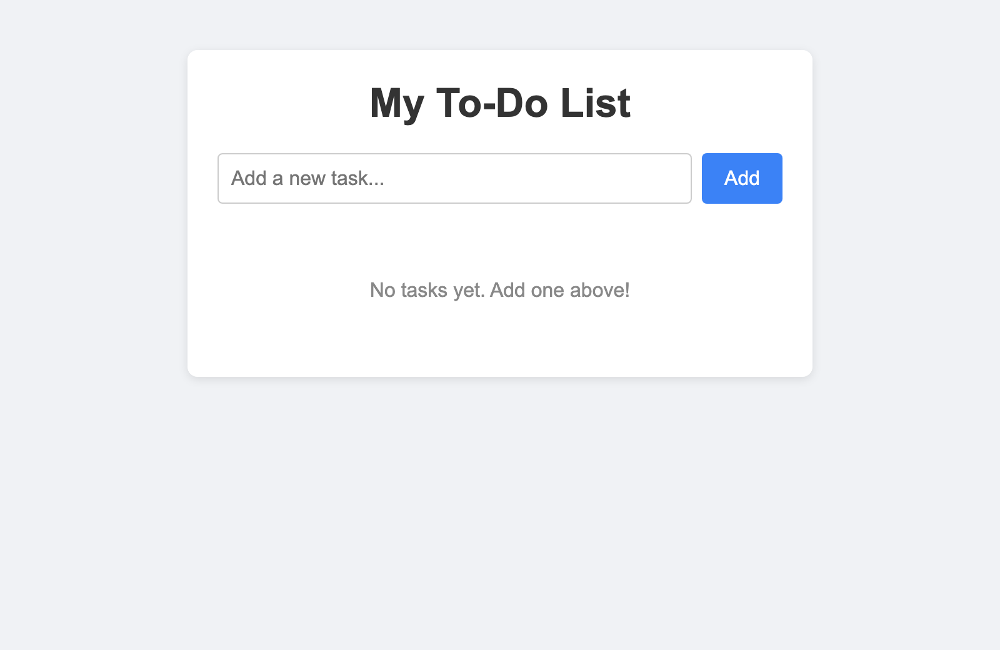
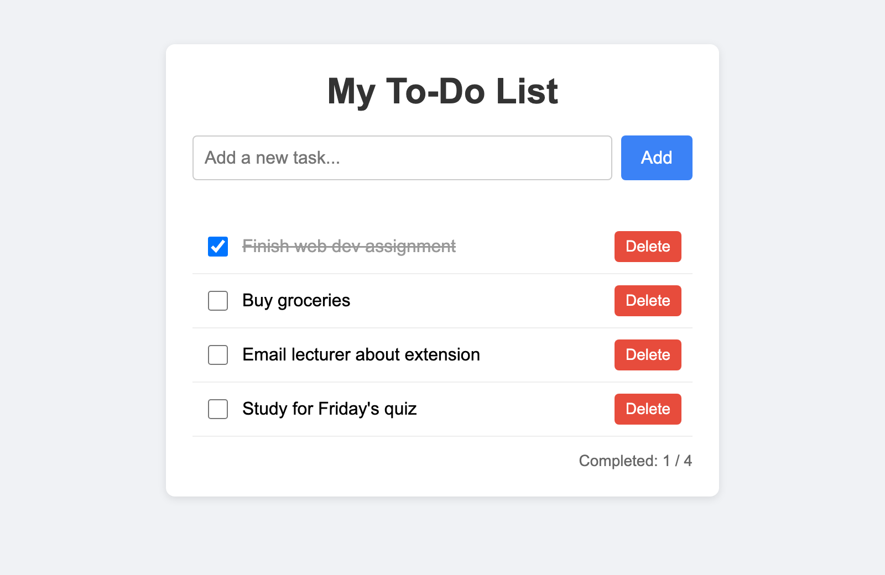

# Assignment 3 – Interactive To-Do List

**Name:** Selim El Fata  
**Matricule:** 241656

A simple to-do list app made with plain HTML, CSS and JavaScript (no frameworks).

## How to run

Just open `index.html` in your browser. No server or install needed.

## Features

- Add a task with the **Add** button or by pressing **Enter**
- Tick the checkbox (or click the task text) to mark a task as done – it gets a strikethrough
- Delete a task with the **Delete** button
- Tasks are saved in `localStorage`, so they are still there after refreshing the page
- Empty or space-only tasks are not added and an error message is shown
- Shows how many tasks are completed

## How the code works

All tasks are stored in a `tasks` array. Every time something changes, the array is
saved to localStorage and `renderTasks()` redraws the list from the array.

Main functions in `script.js`:

| Function | What it does |
| --- | --- |
| `loadTasks()` | Reads the saved tasks from localStorage |
| `saveTasks()` | Saves the tasks array to localStorage |
| `addTask(text)` | Adds a new task to the array |
| `toggleTask(id)` | Marks a task done / not done (uses `map`) |
| `deleteTask(id)` | Removes a task (uses `filter`) |
| `createTaskElement(task)` | Builds the `<li>` for one task |
| `renderTasks()` | Clears the list and draws all tasks again |
| `handleSubmit(event)` | Checks the input and adds the task |

## Screenshots

### No tasks

### With tasks

